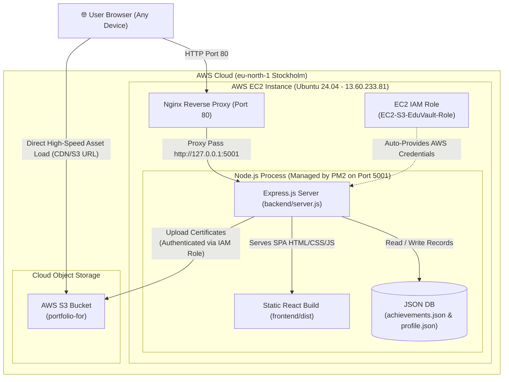

# EduVault - Complete End-to-End Deployment & Architecture Guide

This document is your permanent reference manual for the **EduVault** Educational Achievement & Certificate Portfolio. It covers every concept, configuration, AWS setup, and command executed—both locally and on the AWS cloud—so you can easily reproduce, maintain, and revise this architecture manually in the future.

---

## 1. System Architecture Overview



### Key Architectural Strengths:
1. **Zero Secret Leaks**: No AWS Secret Access Keys are hardcoded in the codebase or in `.env`. The AWS SDK on EC2 automatically fetches temporary credentials from the attached **EC2 IAM Role**.
2. **Unified Single-Server Hosting**: Both Frontend (React 19) and Backend (Express 5) run on the same EC2 instance. This eliminates cross-origin resource sharing (CORS) complications and keeps hosting costs minimal.
3. **High-Performance Static Serving**: Images, diplomas, and PDFs are offloaded to **AWS S3**, ensuring fast, reliable downloads that do not consume server disk space or CPU.

---

## 2. Directory Structure

```text
portfolio/
├── package.json              # Root project scripts (dev, build, install:all)
├── README.md
├── DEPLOYMENT_GUIDE.md       # Complete deployment & maintenance documentation
├── backend/
│   ├── .env                  # Environment variables (Port, S3 Bucket, Region)
│   ├── .env.example          # Sample environment template
│   ├── package.json          # Express, Multer, @aws-sdk/client-s3, cors, uuid
│   ├── server.js             # Core Express API, S3 uploader, static SPA host
│   ├── data/                 # JSON database storage
│   │   ├── achievements.json # All certificate records & metadata
│   │   └── profile.json      # Student bio, skills, and social links
│   └── uploads/              # Local disk staging directory for Multer
└── frontend/
    ├── package.json          # React 19, Vite, Tailwind CSS v4, Lucide icons
    ├── vite.config.js        # Vite bundler configuration
    ├── index.html            # Main HTML document
    ├── dist/                 # Production production bundle (generated on build)
    └── src/
        ├── App.jsx           # Main UI container, tabs, modals, filters
        ├── main.jsx          # React DOM entry point
        ├── index.css         # Tailwind styles & theme variables
        ├── components/       # UI Components (Cards, Modals, Forms)
        └── services/
            └── api.js        # API service layer (relative endpoints /api/...)
```

---

## 3. What Was Implemented in Code (Behind the Scenes)

### A. AWS S3 SDK Integration in `backend/server.js`
- Installed `@aws-sdk/client-s3` instead of the legacy `aws-sdk` v2.
- Created an S3 client initialized with the specified AWS Region:
  ```javascript
  import { S3Client, PutObjectCommand } from '@aws-sdk/client-s3';
  const s3 = new S3Client({ region: process.env.AWS_REGION || 'eu-north-1' });
  ```
- Created the S3 file uploader function:
  ```javascript
  async function uploadToS3(file) {
    const fileStream = fs.createReadStream(file.path);
    const command = new PutObjectCommand({
      Bucket: S3_BUCKET,
      Key: file.filename,
      Body: fileStream,
      ContentType: file.mimetype
    });
    await s3.send(command);
    return `https://${S3_BUCKET}.s3.${AWS_REGION}.amazonaws.com/${file.filename}`;
  }
  ```
- **Fallback mechanism**: If `S3_BUCKET_NAME` is missing or AWS returns an error, the backend gracefully falls back to local disk storage (`/uploads/filename`) so uploads never crash the server.

### B. Single-Port Fullstack Serving in `backend/server.js`
- Express serves both the REST API and the built React SPA:
  ```javascript
  const FRONTEND_DIST = path.join(__dirname, '..', 'frontend', 'dist');

  if (fs.existsSync(FRONTEND_DIST)) {
    app.use(express.static(FRONTEND_DIST));
    // SPA Wildcard Middleware (Express 5 compatible)
    app.use((req, res, next) => {
      if (!req.path.startsWith('/api') && !req.path.startsWith('/uploads') && req.method === 'GET') {
        return res.sendFile(path.join(FRONTEND_DIST, 'index.html'));
      }
      next();
    });
  }
  ```

---

## 4. AWS Cloud Infrastructure Setup

### Step 1: AWS EC2 Instance
- **AMI**: Ubuntu 24.04 LTS (64-bit x86)
- **Instance Type**: `t3.micro` (Free Tier eligible)
- **Region**: `eu-north-1` (Stockholm)
- **Security Group Inbound Rules**:
  | Type | Port Range | Source | Purpose |
  | :--- | :--- | :--- | :--- |
  | SSH | 22 | My IP / 0.0.0.0/0 | Terminal / SSH Access |
  | HTTP | 80 | 0.0.0.0/0 | Public Web Access (via Nginx) |
  | Custom TCP | 5001 | 0.0.0.0/0 | Direct Node Backend Access |

---

### Step 2: AWS S3 Bucket Setup
1. Created bucket named: **`portfolio-for`** (Region: `eu-north-1`).
2. Disabled **"Block all public access"** so uploaded images/PDFs can be viewed on the web.
3. Added the **Bucket Policy** under *Permissions -> Bucket Policy*:
   ```json
   {
     "Version": "2012-10-17",
     "Statement": [
       {
         "Sid": "PublicReadGetObject",
         "Effect": "Allow",
         "Principal": "*",
         "Action": "s3:GetObject",
         "Resource": "arn:aws:s3:::portfolio-for/*"
       }
     ]
   }
   ```

---

### Step 3: EC2 IAM Role Creation & Attachment
1. In AWS IAM Console -> **Roles** -> **Create Role**.
2. **Trusted Entity**: AWS Service -> **EC2**.
3. **Permissions Policy**: `AmazonS3FullAccess`.
4. **Role Name**: `EC2-S3-EduVault-Role`.
5. **Attach to EC2**:
   - Go to EC2 Console -> Select instance -> **Actions** -> **Security** -> **Modify IAM Role**.
   - Select `EC2-S3-EduVault-Role` and click **Update IAM Role**.

---

## 5. EC2 Server Configuration Commands

Execute these steps sequentially when setting up a fresh EC2 instance or revising the server setup.

### Step 1: Install System Packages & Node.js
```bash
sudo apt update && sudo apt upgrade -y
sudo apt install -y git curl nginx

# Install Node.js 20 LTS
curl -fsSL https://deb.nodesource.com/setup_20.x | sudo -E bash -
sudo apt install -y nodejs

# Verify versions
node -v
npm -v

# Install PM2 Process Manager globally
sudo npm install -g pm2
```

---

### Step 2: Clone Codebase & Install Dependencies
```bash
cd ~
git clone https://github.com/Mrkhan56/portfolio.git
cd ~/portfolio

# Install backend dependencies
cd ~/portfolio/backend
npm install
npm install @aws-sdk/client-s3

# Install frontend dependencies and build production assets
cd ~/portfolio/frontend
npm install
npm run build
```

---

### Step 3: Configure Environment Variables
Inside `~/portfolio/backend/.env`:
```bash
cd ~/portfolio/backend
cat << 'EOF' > .env
PORT=5001
NODE_ENV=production
UPLOAD_LIMIT_MB=25
AWS_REGION=eu-north-1
S3_BUCKET_NAME=portfolio-for
EOF
```

> [!IMPORTANT]
> The region string must use a hyphen (`eu-north-1`), never an underscore (`eu_north-1`).

---

### Step 4: Configure Nginx as Reverse Proxy
Open or replace the default Nginx configuration:
```bash
sudo nano /etc/nginx/sites-available/default
```

Replace its contents with:
```nginx
server {
    listen 80 default_server;
    listen [::]:80 default_server;

    server_name _;

    client_max_body_size 50M;

    location / {
        proxy_pass http://127.0.0.1:5001;
        proxy_http_version 1.1;
        proxy_set_header Upgrade $http_upgrade;
        proxy_set_header Connection 'upgrade';
        proxy_set_header Host $host;
        proxy_cache_bypass $http_upgrade;
        proxy_set_header X-Real-IP $remote_addr;
        proxy_set_header X-Forwarded-For $proxy_add_x_forwarded_for;
    }
}
```

Test and reload Nginx:
```bash
sudo nginx -t
sudo systemctl restart nginx
sudo systemctl enable nginx
```

---

### Step 5: Start Backend with PM2
```bash
cd ~/portfolio/backend
pm2 start server.js --name "server"
pm2 startup
# (Run the sudo env PATH=... command that pm2 startup outputs if prompted)
pm2 save
```

---

## 6. Daily Workflow & Future Code Updates

When you make changes to your code locally on your laptop, follow this simple workflow to deploy updates:

### On Your Local Computer:
```bash
# 1. Check changes
git status

# 2. Stage and commit
git add .
git commit -m "Describe your changes"

# 3. Push to GitHub
git push origin main
```

### On Your EC2 Server:
```bash
# 1. Pull latest code
cd ~/portfolio
git pull origin main

# 2. If you changed frontend code, rebuild frontend:
cd ~/portfolio/frontend
npm run build

# 3. If you changed backend code or .env, reload PM2:
cd ~/portfolio/backend
pm2 restart all --update-env

# 4. Check live logs to ensure zero errors:
pm2 logs --lines 15
```

---

## 7. Common Troubleshooting Cheat Sheet

| Symptom | Root Cause | Solution |
| :--- | :--- | :--- |
| `Region not accepted: region="eu_north-1"` | Typo with underscore instead of hyphen | Run `sed -i 's/eu_north-1/eu-north-1/g' .env` and restart with `pm2 restart all --update-env` |
| `Process or Namespace allcd not found` | Shell command chained without spaces | Run commands separately: `pm2 restart all` then `cd ~/portfolio/backend` |
| `local changes would be overwritten by merge` | Git conflict on EC2 file (e.g. `package.json`) | Run `git checkout -- <filename>` then `git pull origin main` |
| Image doesn't load from S3 (`Access Denied`) | Bucket policy missing or Block Public Access enabled | Check S3 permissions tab, ensure `s3:GetObject` statement exists for bucket |
| 502 Bad Gateway | Backend server crashed or is not running on port 5001 | Run `pm2 status` and check logs using `pm2 logs server --lines 30` |
| Port 80 not responding | EC2 Security Group is missing HTTP rule | In AWS Console, add Inbound rule for HTTP (Port 80) from `0.0.0.0/0` |

---

## 8. Summary of Active Resources

- **Public IP**: `http://13.60.233.81`
- **EC2 Instance ID**: `i-0f47a7602000fd2ae` (Region `eu-north-1`)
- **S3 Bucket**: `portfolio-for` (`https://portfolio-for.s3.eu-north-1.amazonaws.com`)
- **GitHub Repository**: `https://github.com/Mrkhan56/portfolio` (Branch: `main`)
- **Process Manager**: PM2 process `server` running `backend/server.js` on port `5001`
